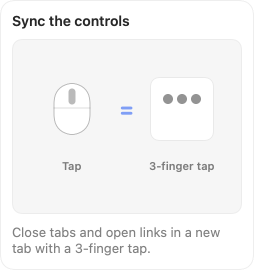
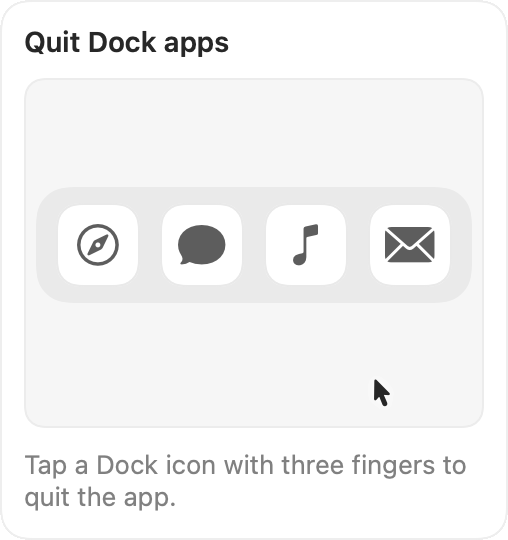
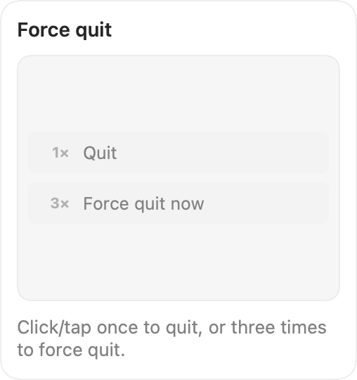

# UXTapFix

Improve missing UX on your MacBook. A three-finger tap that closes tabs, opens links, and quits Dock apps.

<p align="center">
  
  
  
</p>

- Close tabs and open links in a new tab with a 3-finger tap.
- Tap a Dock icon with three fingers to quit the app.
- Click or tap once to quit, or three times to force quit.

Setup installs a small background service in your user folder and helps you grant the permissions macOS requires. No admin password, and it never phones home. Requires **macOS 13** or later.

The trackpad gesture uses Apple's private `MultitouchSupport.framework` (weak-linked, not App Store compatible). A real middle-click mouse still quits Dock apps if that framework is missing.

## Install

Download the instaler from latest [release]([url](https://github.com/janmichek/UXTapFix/releases/)) . Continue with helpful installer setup.

## Permissions

**Accessibility** is required. It lets UXTapFix see which Dock icon is under the pointer and create the event tap. macOS requires you to flip the switch yourself. After you do, Setup restarts the service; the daemon also retries the tap on its own.

This build uses an active filtering tap, which Accessibility authorizes. It does not need a separate Input Monitoring entry. Leave `ListenEvent` alone; resetting it drops the app from that pane, and an ad-hoc build cannot reliably add itself back.

If System Settings shows Accessibility on but Setup stays off, the grant belongs to an older signature. Click **Open System Settings** again — Setup clears the stale record — or run:

```sh
tccutil reset Accessibility com.user.uxtapfix
```

## Gestures

| Where | What happens |
| --- | --- |
| Dock icon, once | The app quits and any leftover helpers stop. It is never force-quit, so a save sheet can stay open. |
| Same Dock icon, twice | Same as once. There is no separate second-click action. |
| Same Dock icon, 3× | Force quit. |
| Browser tab | The tab closes (Chrome, Safari, Firefox, Arc, and most others). |
| A link | Opens in a background tab. |
| Terminal | Pastes the selection. |

Clicks on one Dock icon count when each follows the last within your double-click speed (at least half a second). A single click waits that long; a third click force-quits immediately. Clicks outside the Dock are not counted or delayed.

On macOS 26 and later, a quit app can linger in the Dock as **Running in Background**. UXTapFix then runs the Dock's **Stop Running in Background** command.

Quit MiddleClick if it is still installed (`brew uninstall --cask middleclick`); both apps would post a click. If a three-finger tap opens Look Up, set **System Settings → Trackpad → Point & Click → Look up & data detectors** to **Force Click with one finger**.

Finder, Trash, Launchpad, and Mission Control are ignored. To allow quitting Finder (it relaunches immediately), set `middleClickAllowFinderQuit` or run `enable-finder-quit.sh`.

Defaults live in `com.user.uxtapfix`. After a change:

```sh
launchctl kickstart -k gui/$(id -u)/com.user.uxtapfix
```

